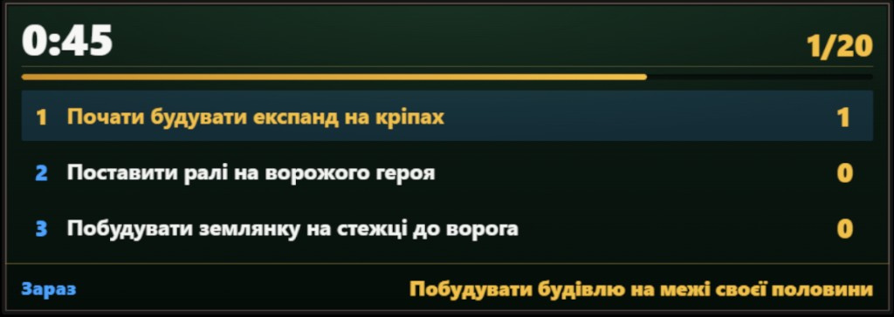

# Віджет для стріму

Я зробив цей віджет для Warcraft III. Це челендж з використанням чату: чат голосує, яке завдання тобі робити.

## OBS

Додай джерело «Браузер».

- Адреса: https://challenge-for-foggy.duckdns.org/overlay
- Ширина: 1000
- Висота: 700

Якщо джерело порожнє, натисни на ньому правою кнопкою і вибери «Оновити».

## Як грати

Грати тільки за орків.

Кожні 3 хвилини чат голосує `1`, `2` або `3`. Поки йде голосування, ти робиш те, що висить знизу в «Зараз». Це завдання на ці 3 хвилини.

Перші 3 хвилини ще без завдання. «Зараз» з’явиться після першого голосування.

Один глядач — один голос. Нова цифра замінює стару. Голоси тільки в чаті Twitch, точно `1`, `2` або `3`.

Решту часу граєш як хочеш.

Головне — закрити мінімум **10/10** і виграти матч. 10 — це лише мінімум. Навіть після 10/10 завдання з чату треба виконувати далі, поки не буде перемоги.

## Команди

Коли матч почався, напиши у свій чат Twitch:

- `cstart` — запустити або перезапустити з нуля
- `coff` — вимкнути завдання
